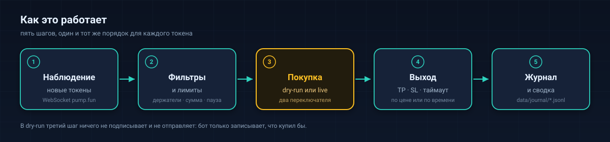
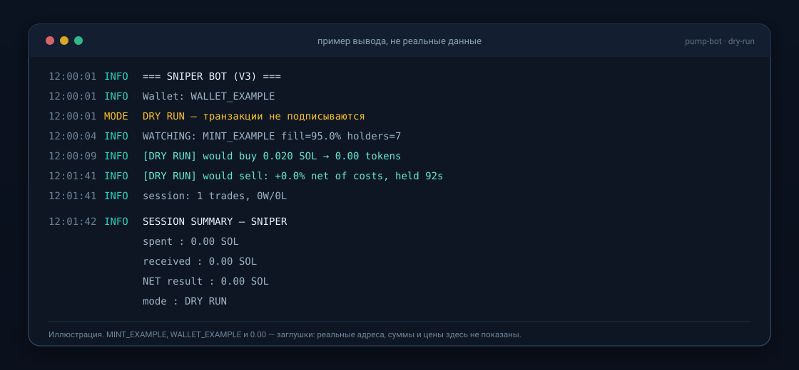

<p align="center"></p>

<p align="center"><b>Боты для pump.fun (Solana) · dry-run по умолчанию · исследовательский инструмент, а не способ заработка.</b></p>

<h1 align="center">pump-bot</h1>

<p align="center">Небольшие боты, которые следят за pump.fun в сети Solana и могут покупать и продавать мемкоины за вас — сначала на бумаге, за реальные деньги только если вы сами этого захотите.</p>

## Содержание

- [Сначала прочтите это](#сначала-прочтите-это)
- [Что делает проект](#что-делает-проект)
- [Жизнь токена на pump.fun](#жизнь-токена-на-pumpfun)
- [Что нового](#что-нового)
- [Быстрый старт: dry-run без денег](#быстрый-старт-dry-run-без-денег)
- [Dry-run и live](#dry-run-и-live)
- [Какой бот мне нужен](#какой-бот-мне-нужен)
- [Лимиты безопасности](#лимиты-безопасности)
- [Продать всё](#продать-всё)
- [Это проверено?](#это-проверено)
- [Безопасность в четырёх строках](#безопасность-в-четырёх-строках)
- [Документация](#документация)
- [Лицензия](#лицензия)

## Сначала прочтите это

> ⚠️ **Вы можете потерять всё, что положите на кошелёк.** Цена мемкоина падает на 99% за минуту,
> а некоторые токены не продаются вообще. Это **не инвестиционный совет**: прибыль здесь никто не
> обещает, а код — исследовательский инструмент, и в нём могут быть ошибки.
>
> Начните с **dry-run** — в этом режиме деньги не двигаются. Если когда-нибудь перейдёте в live,
> берите **новый одноразовый кошелёк** и только ту сумму, которую не страшно потерять целиком.

<p align="center"></p>

## Что делает проект

- Следит за блокчейном Solana и видит новые токены pump.fun в момент появления.
- Покупает и продаёт по простым правилам: тейк-профит, стоп-лосс или таймаут.
- Умеет копировать сделки другого кошелька и входить за шаг до «выпуска» токена (graduation).
- По умолчанию работает в **dry-run**: записывает, что сделал бы, и не подписывает ни одной транзакции.
- Даёт инструменты только для чтения: поток новых токенов, локальный дашборд, исследовательские
  скрипты и shadow-лабораторию, которая сравнивает варианты стратегии на бумаге.
- Ключ лежит в файле на вашем компьютере; наружу уходит только уже подписанная транзакция.

## Жизнь токена на pump.fun

```text
 создание ──► bonding curve (кривая) ──────────────► graduation ──► пул PumpSwap
              цена растёт с каждой покупкой            100%,         обычный AMM-пул,
              0% ············ 75–90% ······· 100%     ≈ 85 SOL      своя цена и комиссии
                              ▲
                              graduation-бот входит здесь (полоса настраивается в .env)
```

Пока токен на **кривой**, купить и продать его можно только через неё. Когда кривая заполнена
(**graduation**), торговля переезжает в пул **PumpSwap**, и цена там уже своя. Снайпер покупает
токены сразу после создания; graduation-бот — незадолго до graduation.

## Что нового

- **Честнее про комиссию PumpSwap.** Котировка продажи теперь берёт реальную комиссию пула (~1.2%, а не 0.3%) — shadow стал честнее, старые результаты были оптимистичнее примерно на 1%. У AMM-продажи свой лимит вычислений (`AMM_SELL_CU_LIMIT=160000`). Если продажа «упала», но на самом деле прошла позже — бот её найдёт и запишет. Live-боты замечают замирание консоли.
- **Shadow: найдено «замирание» процесса.** Вероятно, из-за паузы консоли Windows (клик / выделение текста в окне — QuickEdit) бот переставал видеть сделки, и 5 токенов в прогоне показали -95%. Теперь shadow это замечает и не записывает такие сделки как результат; добавлены варианты K/L/M/N. Совет: запускать ботов в Windows Terminal или терминале VS Code и не выделять текст в окне бота.
- **Повторы продажи и страховка от зависшей позиции.** sniper больше не повторяет неудачную продажу бесконечно, а copy-trader больше не бросает её: до `SELL_MAX_ATTEMPTS` попыток (по умолчанию 3) с паузами 2 с, 4 с, …, потом позиция помечается STUCK. copy-trader сам продаёт позицию целиком, если цель не продала за 30 минут (`COPY_MAX_HOLD_SEC=1800`, `0` = выключить).
- **Возврат ренты за токен-счёт.** После полной продажи бот закрывает опустевший счёт токена и возвращает ~0.002 SOL ренты (≈10% ставки 0.02). Продажа от этого не зависит — закрытие идёт отдельной транзакцией в фоне. Отключить: `ATA_CLOSE=no`. Старые пустые счета: `node scripts/close-empty-atas.mjs` (без флагов только показывает, ничего не отправляет).
- **Проверка выхода перед покупкой (graduation-бот).** Прежде чем купить, бот просит сеть
  *симулировать* «купить и сразу продать» в одной транзакции. Симуляция ничего не отправляет и не
  тратит. В live бот не покупает, если продажа в симуляции не проходит. В dry-run результат только
  записывается в журнал (`preBuySim`), покупка на бумаге не блокируется.
- **Shadow-лаборатория** — `node bots/graduation-sniper/shadow.mjs`. Только чтение: на одном потоке
  сделок бумажно гоняет сразу несколько вариантов стратегии и пишет каждый вход и выход в журнал.
  Вариант **J** — это ваши собственные настройки `GRAD_*` из `.env`, то есть ответ на вопрос
  «как бы торговал мой конфиг». С `--live` лаборатория не запускается. Отчёт:
  `node scripts/analyze-graduation.mjs`. Подробнее — [docs/research.md](docs/research.md).
- **Честная цена после graduation.** Когда токен переехал в PumpSwap, кривая замолкает, а её последняя
  цена — самая высокая за всю жизнь токена. Раньше бумажные позиции закрывались по этой «замороженной»
  цене, и результат выглядел лучше реального. Теперь выход считается по котировке пула PumpSwap. Если
  котировки нет, сделка записывается **без результата** и в средние не попадает.
- **Статус: прибыльность не доказана.** Данные только собираются. Выводы о прибыли делаем не раньше,
  чем наберётся **200 и больше разных токенов**; до этого любые цифры в журнале — шум.

## Быстрый старт: dry-run без денег

Понадобится **Node.js 22 или новее** (проверить: `node -v`). Всё остальное — пять шагов ниже.
Команды для Windows даны для PowerShell, для macOS и Linux — для bash; различаются они только
копированием файла настроек.

**1. Скачайте код и поставьте библиотеки**

```powershell
# Windows (PowerShell)
git clone <URL-вашего-форка>
cd pump-bot
npm ci --ignore-scripts
```

```bash
# macOS / Linux (bash)
git clone <URL-вашего-форка>
cd pump-bot
npm ci --ignore-scripts
```

**2. Создайте файл настроек из шаблона**

```powershell
Copy-Item .env.example .env
```

```bash
cp .env.example .env
```

**3. Откройте `.env` в любом редакторе и задайте `RPC_URL`** — адрес своего Solana RPC. Бесплатный
публичный endpoint будет постоянно упираться в лимиты, и бот будет выглядеть «заснувшим». Если
`RPC_URL` не задан, бот остановится сразу с сообщением `RPC_URL is required`.

**4. Создайте пустой кошелёк**

```powershell
node lib/wallet.mjs generate
```

Команда только записывает файл `keys/default.json` в папку проекта: денег не тратит, в сеть не
ходит. Что внутри файла и зачем нужен `--force` — в [docs/wallet-and-keys.md](docs/wallet-and-keys.md).

**5. Запустите снайпер в dry-run**

```powershell
npm run sniper
```

Бот печатает токены, которые «купил бы», и выходы, которые «сделал бы». Ничего не подписывается и
никуда не отправляется. Остановка — `Ctrl+C`.



Иногда появляется безобидное предупреждение `bigint: Failed to load bindings` — это нормально и на
работу не влияет.

Пошаговый разбор с пояснениями: [docs/getting-started.md](docs/getting-started.md).

## Dry-run и live

| Режим | Что происходит | Чем рискуете |
|---|---|---|
| **dry-run** (по умолчанию) | Решения принимаются, «сделка» считается виртуально, журнал пишется. Ни одна транзакция не подписывается и не отправляется. | Ничем |
| **live** | Настоящие транзакции подписываются ключом из `keys/` и уходят в сеть. | Всем, что лежит на кошельке |

Для live нужны **два** переключателя одновременно: флаг `--live` **и** переменная
`LIVE_CONFIRM=yes` в той же оболочке. По отдельности каждого мало — бот останавливается ещё до
подключения к сети. Флаг `--dry-run` отменяет `--live`.

```powershell
# Windows (PowerShell): переменная живёт только внутри этого процесса
$env:LIVE_CONFIRM="yes"; npm run sniper -- --live
```

```bash
# macOS / Linux
LIVE_CONFIRM=yes npm run sniper -- --live
```

Отдельный переключатель `LIVE_CONFIRM_AMM=yes` относится к продаже токена, который уже уехал на
PumpSwap: этот путь **не проверен на реальной транзакции**, и без явного согласия бот такой токен
пропускает.

## Какой бот мне нужен

| Команда | Что делает | Риск | Новичку подходит? |
|---|---|---|---|
| `npm run monitor` | Печатает новые токены и сделки по мере появления. | Только чтение | ✅ Да, с него и начните |
| `npm run analytics` | Локальный веб-дашборд: что бот видит прямо сейчас. | Только чтение | ✅ Да |
| `npm run lab` · `npm run replay` | Бумажная торговля и исследование «обучение/тест» на истории. | Денег нет | ✅ Да |
| `node bots/graduation-sniper/shadow.mjs` | Shadow-лаборатория: варианты graduation-стратегии (включая ваш конфиг — вариант J) на бумаге. | Только чтение | ✅ Да |
| `npm run sniper` | Покупает новые токены, прошедшие фильтры; выход по TP, SL или таймауту. | Торгует | 🟡 Только в dry-run |
| `npm run graduation` | Входит за шаг до завершения кривой токена. | Торгует | 🟡 Только в dry-run |
| `npm run trade` | Ручные buy / sell / price / balance из командной строки. | Торгует | 🟡 Если понимаете, что делаете |
| `npm run copy` | Повторяет сделки кошельков из `COPY_TARGETS`. | Торгует | ❌ Не для первого запуска |

«Торгует» всегда означает «пока не добавлен `--live` — считает на бумаге». Все флаги каждого
бота: [docs/bots.md](docs/bots.md) · все команды npm: [docs/commands.md](docs/commands.md).

## Лимиты безопасности

Три жёстких лимита не дают одному плохому дню превратиться в катастрофу. Это значения по умолчанию
из `.env.example`:

- **На сделку — 0.05 SOL** (`MAX_TRADE_SOL`). Сделка больше лимита пропускается, бот продолжает работу.
- **На сессию — 0.1 SOL** на покупки (`MAX_SESSION_SOL`). Когда лимит исчерпан, бот перестаёт слушать,
  закрывает что может (только в live), печатает сводку и завершается.
- **Серия убытков — 3 подряд** (`MAX_CONSEC_LOSSES`). Сессия заканчивается вместо «отыгрыша».

Для `MAX_SESSION_SOL` и `MAX_CONSEC_LOSSES` значение `0` означает «без лимита». Для `MAX_TRADE_SOL`
`0` означает «запретить все сделки» — намеренно: пропущенное значение не должно означать «без
ограничений». Полный список настроек: [docs/configuration.md](docs/configuration.md).

## Продать всё

`scripts/sell-all.mjs` показывает все токены, которые ещё лежат на кошельке, и с `--live` продаёт их
по одному. Это спасательный инструмент, а не стратегия: он никогда не покупает и не открывает позиций.

```powershell
node scripts/sell-all.mjs
```

Запуск по умолчанию — **только план**. Печатается таблица (mint, баланс, площадка, ожидаемо SOL,
статус), ничего не отправляется и не подписывается.

Чтобы действительно продать:

```powershell
$env:LIVE_CONFIRM="yes"; node scripts/sell-all.mjs --live
```

Без `LIVE_CONFIRM=yes` скрипт завершается раньше, чем создаст RPC-клиент.

Токены на кривой продаются через кривую. Токены, которые уже перешли на PumpSwap, идут другим путём
и требуют отдельного согласия `LIVE_CONFIRM_AMM=yes`: раскладка продажи PumpSwap **пока не проверена
в сети** (программа отвечает `Custom 6062`). Без этого флага токен пропускается с сообщением
`PumpSwap sell unverified`, и ничего не отправляется.

Каждая продажа сначала симулируется. Неудачная симуляция печатает логи программы, токен
пропускается, работа продолжается со следующим. Отправки идут по очереди, автоматических повторов
нет. Каждое решение попадает в `data/journal` как `sell_all_plan`, `sell_all_sent`,
`sell_all_skipped` или `sell_all_failed`.

**Для токенов на PumpSwap разумнее продать вручную через Jupiter или Photon**, пока выход через
PumpSwap не подтверждён на реальной транзакции.

## Это проверено?

**Нет.** Опубликованных результатов нет: ни бэктеста, ни истории сделок, ни утверждения, что
какая-то стратегия здесь зарабатывает. Что есть — набор тестов (`npm test`, 71 файл), который
работает офлайн, и аудит с вердиктом по каждой найденной проблеме. Тесты доказывают, что код делает
заявленное; о прибыли они не говорят ничего. Прежде чем верить цифрам в логах, прочитайте
[docs/verification-status.md](docs/verification-status.md).

Сейчас идёт сбор данных в dry-run и shadow-лаборатории. Каждый токен считается одним наблюдением,
сколько бы сделок по нему ни было. Вывод о прибыльности допустим только от **200 разных токенов**,
и только после всех издержек: комиссий pump.fun и PumpSwap, проскальзывания, сетевых комиссий.
Выход через PumpSwap на реальной транзакции пока не проверен.

Отчёты разработки лежат в [docs/dev-reports/](docs/dev-reports/). Это не результаты торговли.

## Безопасность в четырёх строках

- **Никому не показывайте `keys/`.** Там приватный ключ открытым текстом. Относитесь как к наличным.
- **Никогда не коммитьте `.env`.** Там ваш RPC-адрес, часто вместе с платным API-ключом.
- **Прочитайте код подписи** до запуска в live: `lib/wallet.mjs`, `lib/tx.mjs`, `lib/send.mjs`.
- **Берите свой RPC.** Чужой или перегруженный endpoint может скрывать и задерживать данные.

Резервную копию ключа держите на офлайн-носителе. И главное: **не запускайте это с основного
кошелька** и не храните на этом адресе сбережения — только сумму, которую готовы потерять целиком.

Подробнее: [docs/security.md](docs/security.md) · кошелёк и ключи:
[docs/wallet-and-keys.md](docs/wallet-and-keys.md) · настройки: [docs/configuration.md](docs/configuration.md) ·
ошибки: [docs/errors-and-troubleshooting.md](docs/errors-and-troubleshooting.md).

## Документация

| Документ | О чём |
|---|---|
| [docs/getting-started.md](docs/getting-started.md) | С нуля: Node.js, `.env`, кошелёк, первый dry-run, словарь терминов |
| [docs/bots.md](docs/bots.md) | Все восемь ботов: флаги, переменные, что пишут в журнал |
| [docs/commands.md](docs/commands.md) | Полные таблицы команд `npm run …` и вспомогательных скриптов |
| [docs/configuration.md](docs/configuration.md) | Каждая переменная `.env`: смысл и значения по умолчанию |
| [docs/wallet-and-keys.md](docs/wallet-and-keys.md) | Генерация кошелька, где лежит ключ, резервная копия |
| [docs/architecture.md](docs/architecture.md) | Как устроено внутри: RPC, парсер, расчёты, отправка |
| [docs/errors-and-troubleshooting.md](docs/errors-and-troubleshooting.md) | Тексты ошибок и что с ними делать |
| [docs/verification-status.md](docs/verification-status.md) | Что проверено, что нет и почему |
| [docs/security.md](docs/security.md) | Угрозы и правила обращения с ключами |
| [docs/research.md](docs/research.md) | Лаборатория, shadow-лаборатория graduation, реплеи, исследовательские отчёты |
| [docs/dev-reports/](docs/dev-reports/) | Отчёты разработки (не торговые результаты) |

## Лицензия

**Не указана.** В исходном репозитории лицензии не было, поэтому здесь она тоже не предоставляется и
предполагать её нельзя. Если планируете распространять код, спросите автора оригинала.

Программа предоставляется «как есть», без гарантий любого рода. Торговля мемкоинами может привести к
полной потере вложенных средств; ничто в этом репозитории не является инвестиционной рекомендацией.
Ответственность за ключи, деньги и соблюдение законов вашей страны лежит на вас.


