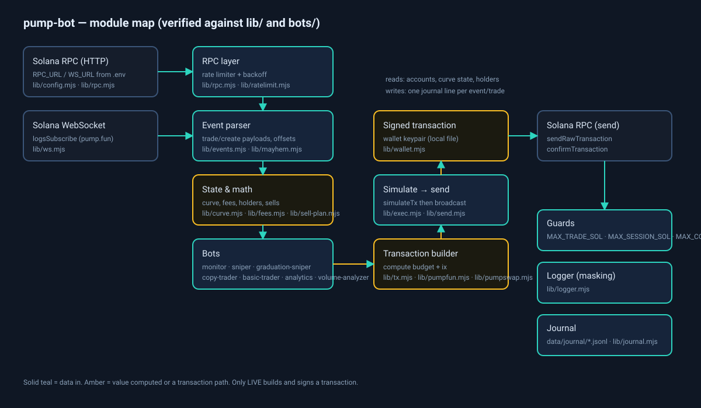

# Architecture

## Modules (`lib/`)

| Module | Responsibility |
|---|---|
| `config.mjs` | Loads `.env` (without overriding real env vars), validates numbers, requires `RPC_URL`, derives `WS_URL`, computes `LIVE`/`DRY_RUN`, enforces `LIVE_CONFIRM=yes`, caps the priority fee |
| `wallet.mjs` | The only module that reads `keys/<name>.json` (`Keypair.fromSecretKey`) |
| `rpc.mjs` | Shared `Connection` (built-in 429 retry disabled, `RPC_TIMEOUT_MS` hard deadline on every HTTP call), rate-limited `rpcCall`, `sendTxWithRetry`, RPC stats (calls, 429s, errors, failed-tx fees) |
| `ratelimit.mjs` | Priority queue (0 = exit, 1 = entry, 2 = ticks, 3 = rest) with 429 counting and a `degraded` flag |
| `retry.mjs` | `withBackoff`, `isRetryable` |
| `ws.mjs` | `SolanaWs`: `logsSubscribe`/`accountSubscribe`, re-subscribe on reconnect, dedup per subscription+signature, exponential backoff, never rejects on a handshake error |
| `events.mjs` | Payload parsing helpers, base58-safe conversion |
| `mayhem.mjs` | Mayhem-mode detection (program id, curve flag, event route) |
| `pumpfun.mjs` | Curve state, buy/sell instructions, fee/buyback recipients from the on-chain `global` account, `calcBuyTokens`/`calcSellSol`/`calcSellQuote` |
| `pumpswap.mjs` | PumpSwap event parsing, canonical pool PDA, `PoolState`/`GlobalConfig` decoding, `ammSellIx` (UNVERIFIED on-chain) |
| `curve.mjs` | Price/impact math, plausible-band checks, `gradFillPct` (real-reserve fill) |
| `fees.mjs` | Cost model: pump 1% in + 1% out, priority fee, base tx fee, assumed slippage |
| `exec.mjs` | `readExecution` (actual SOL/tokens from tx meta), `previewExit` (round-trip gate), `simulateTx` |
| `send.mjs` | `simulateThenSend`: simulate first, then broadcast with `skipPreflight` |
| `sell-plan.mjs` | Splits a sale so every part's payout fits `0.95 × realSolReserves`; steps the curve between parts |
| `pump-errors.mjs` | IDL error table (111 codes) + `describeTxError` + classifiers |
| `guards.mjs` | `TradeGuard`: per-trade cap, session cap, consecutive-loss halt |
| `session.mjs` | Session ledger and the one-shot summary (spent / received / NET, costs, wallet delta, failed-tx fees, STUCK) |
| `journal.mjs` | JSONL writer/reader, `costsScheme` stamping, dedupe, summaries |
| `ticks.mjs` | Rotating tick log with `ageMs` and `stale` flags |
| `logger.mjs` | Leveled logger with secret masking (JSON byte arrays, `secretKey=` blobs, 80–90 char base58) |
| `pessimistic.mjs` | Pessimistic execution model: 200–800 ms delay, size slippage, full costs |
| `gradstats.mjs` | Mean/median, profit factor, max drawdown, seeded bootstrap CI (n ≥ 30) |
| `shadow.mjs`, `strategy.mjs`, `research.mjs` | Variant definitions and paper-trading logic |
| `holders.mjs`, `holderticks.mjs` | Holder counting and trajectory sampling |
| `runmeta.mjs` | `sessionId`, `paramsHash`, `gitSha` |
| `solprice.mjs` | Optional SOL/USD display price (`SOL_PRICE_SOURCE=off` disables the hosts) |
| `status.mjs`, `time.mjs`, `consistency.mjs`, `creators.mjs`, `rebuild.mjs`, `rawcap.mjs`, `analyzer-core.mjs` | Status line, Moscow timestamps, curve consistency, creator registry, report rebuild, raw capture, transaction analyzer core |

## Data flow

1. **Ingest.** `lib/ws.mjs` subscribes to `logsSubscribe` for the pump.fun program (and for copy
   targets). A reconnect re-subscribes every stored subscription and clears stale handler ids.
2. **Parse.** Logs are scanned for `Instruction: …` names and for `Program data:` payloads with the
   trade-event prefix. The parser reads fixed offsets (below).
3. **Decide.** Each bot applies its own filters, then the shared `TradeGuard`.
4. **Price.** Curve math in `lib/curve.mjs`/`lib/pumpfun.mjs`; costs in `lib/fees.mjs`.
5. **Act.** Dry-run writes a simulated record. Live builds a versioned transaction (`lib/tx.mjs`),
   simulates it (`lib/exec.mjs`), signs with the local key and broadcasts (`lib/send.mjs`).
6. **Record.** `lib/journal.mjs` appends one JSON line per event; `lib/session.mjs` prints the summary
   at stop.

## Event and account layouts (as implemented)

**V3 trade event** (`lib/events.mjs`, `bots/graduation-sniper/graduation.mjs`), little-endian:

| Offset | Size | Field |
|---|---|---|
| 0 | 8 | discriminator `bddb7fd34ee661ee` |
| 8 | 32 | mint |
| 40 | 8 | sol amount (lamports) |
| 48 | 8 | token amount (raw units) |
| 56 | 1 | is_buy |
| 57 | 32 | user |
| 89 | 8 | timestamp |
| 97 | 8 | virtual SOL reserves |
| 105 | 8 | virtual token reserves |
| 113 | 8 | real SOL reserves |
| 121 | 8 | real token reserves |

**Bonding-curve account** (166 bytes): `8` discriminator, `8` virtual token reserves, `16` virtual SOL
reserves, `24` real token reserves, `32` real SOL reserves, `40` token total supply, `48` complete,
`49..81` creator, `81` is_mayhem_mode.

**PumpSwap pool** (`lib/pumpswap.mjs`): `43` base mint, `75` quote mint, `139` base vault, `171` quote
vault, `211` coin creator, `243` is_mayhem_mode, `244` is_cashback_coin, `245` virtual quote reserves
(i128), `261` creator fee bps. The canonical pool is
`PDA(["pool", u16(0), ["pool-authority", mint], mint, WSOL])`.

## Cost model

- Pump fee: **1% on the buy and 1% on the sell** (`lib/fees.mjs`).
- Priority fee: `CU_PRICE × CU_LIMIT / 1e6` lamports — **charged on the requested limit** — plus the
  5000-lamport base fee. `lib/rpc.mjs` estimates the fee of a landed-but-failed transaction this way.
- Curve impact is computed from the reserves, not assumed.
- `SLIPPAGE_ASSUMED_BPS` (default 50) is added on top in the dry-run cost model.
- `lib/pessimistic.mjs` adds a 200–800 ms execution delay and size-dependent slippage for paper modes.

## Guards

`TradeGuard.checkOpen()` returns `{ok}`, `{ok:false,terminal:false}` (skip this trade) or
`{ok:false,terminal:true}` (end the session). `MAX_TRADE_SOL=0` blocks every trade;
`MAX_SESSION_SOL=0` and `MAX_CONSEC_LOSSES=0` disable their checks. `reserve()` is called synchronously
right after the check to close the concurrent-event race, and `release()` rolls it back when a send
fails.

## Journal format

One JSON object per line in `data/journal/YYYY-MM-DD.jsonl`. Every line has `ts` (UTC), `tsMsk`
(Moscow), `bot` and `type`. Trades additionally carry `costsScheme` and the fields written by the bot
(entry/exit price, `solSpent`/`solReceived`, `tokens`, `pnlSol`, `priceSource`, `venue`, attempts,
slippage). Session records add `sessionId`, `paramsHash`, `gitSha` and the RPC snapshot. Tick lines add
`ageMs` and `stale`. The graduation shadow lab writes `gshadow_candidate`, `gshadow_open` and
`gshadow_trade` (with `netPct`, `reason`, `holdSec`, `slipBps`, `delayMs`, `costsScheme`). The
`costsScheme` stamp separates accounting epochs: `v3-single-slip` charges the buy slippage once,
while lines without the field are the older model that charged it twice, so the analyzer reports
them as separate tables.

### costsScheme v2.1 (2026-11-11)

`COSTS_SCHEME` was bumped to `v2.1`. Dry-run accounting did not change, so dry `v2` and `v2.1`
lines can be merged; **live** lines cannot be mixed across this epoch boundary. Field semantics:

| Field | Before | Now |
|---|---|---|
| `readExecution.solSpentSol` | -delta - fee (incl. ATA rent) | -delta - fee - ATA rent |
| `solSpent` in a graduation buy line | entry incl. rent on the first entry into a mint | entry excl. rent; rent in `ataRentSol` |
| `pnlSol` in a graduation sell line | proceeds - entry (incl. rent) | proceeds - entry (excl. rent): ~0.00207 SOL higher on the first entry |
| `pnlSol` in a sniper live line | `received - BUY_SOL - estimated tx*2 - estimated slip` | `received - actual entry` |
| `costsSol` in a sniper live line | estimate (tx*2 + slippage) | actual buy and sell network fees |
| `pnlPctNet` in a sniper line | `pnlSol / BUY_SOL` | same formula with the new `pnlSol`; denominator still the nominal `BUY_SOL` |
| `type:"stuck"` | no `pnlSol` | graduation `markStuck`, sniper and copy-trader: `pnlSol < 0`, `lossAssumed: true` |
| daily total (`netSolForDay`) | only `trade` | `trade` + `stuck` with `lossAssumed: true` |
| `spent` in a live session | incl. rent | excl. rent; rent in `ataRentSol` |
| `received`/NET in a sniper live session | minus the sell fee | before the network fee; fees in `costs` |
| copy-trader journal lines | none | only `stuck` |

Unchanged: all dry-run calculations, shadow (`SHADOW_COSTS_SCHEME`), old `stuck` lines without
`lossAssumed` (excluded from the daily total), and `netAfterCostsSol`.

Live behaviour that changed (no parameters touched):
- A STUCK position is booked as a loss: it increments `MAX_CONSEC_LOSSES` and spends the daily loss
  limit, so a bot may halt (or stop buying) earlier than before.
- ATA rent is accounted separately (`ataRentSol`, `ataRentKnown`) and is no longer part of the entry.
- Proceeds from a manual STUCK sell are **not** returned to the daily total: the assumed loss is not
  reduced even if the position is later sold.
- TP/SL in graduation and sniper are computed from the entry without ATA rent (previously the rent
  skewed the ratio by ~10% at `BUY_SOL = 0.02`).

### costsScheme v2.2 (2026-11-12)

`COSTS_SCHEME` begins at `v2.2`. Dry-run did not change: dry `v2`, `v2.1` and `v2.2` lines are one
model; **live** lines of different versions must not be mixed. Field semantics:

| Field | v2.1 | v2.2 |
|---|---|---|
| `pnlSol`, sniper live sale | proceeds - entry (sell fee inside, no buy fee) | proceeds - entry - both fees; on the mock +0.005 -> +0.004545 |
| `pnlSol`, graduation live sale | proceeds - entry share (no buy fee) | proceeds - entry share - both fees |
| `pnlSol`, graduation recovered sale | share computed from a doubled balance: a full sale booked only half the entry | share from the balance read before the sale |
| graduation sale line | `solReceived`, `pnlSol`, `ataRentSol` | plus `entrySolSol`, `entrySource`, `buyFeeSol`, `sellFeeSol`, `feesActual`, `ataRentKnown`; a recovered sale adds `reconciled: true` and `ataRentSol` |
| `solReceived` | wallet balance delta (or a quote) | unchanged |
| `buyFeeSol` in a sniper line | not part of `pnlSol` | part of `pnlSol` |
| `costs` in a graduation/copy-trader live session | estimate: tx*2 + assumed slippage | actual buy and sell network fees |
| `received` and NET in a graduation/copy-trader live session | minus the sell fee | before network fees; fees in `costs` |
| session "NET after costs" (live, all three bots) | graduation/copy-trader: the sell fee was subtracted twice plus assumed slippage | the sum of `pnlSol` across the trades = wallet balance delta excluding ATA rent |
| `stuck`, "open at stop" (graduation, LIVE) | no `pnlSol`, not in limits | `pnlSol < 0`, `lossAssumed: true` |
| `stuck`, "stop: curve unavailable, not sold" (sniper) | no `pnlSol` | `pnlSol < 0`, `lossAssumed: true` |
| daily total (`netSolForDay`) | did not see positions left open at stop | sees them (LIVE) |
| quote-fallback estimate | `pnlSol` without the sell fee | minus both (estimated) fees, `feesActual: false` |

Unchanged: the entry (`entrySolSol`, `solSpent`) and ATA rent (the v2.1 meaning), `stuck` in DRY RUN,
`stuck` lines without `lossAssumed`, all dry-run calculations, shadow.

Live behaviour that changed:
- the daily loss limit and the journal `pnlSol` use PnL net of BOTH network fees, so a near-zero
  trade lowers the day's net;
- `MAX_CONSEC_LOSSES` classifies a live sale by `guardPnlSol` (PnL before network fees): a trade that
  made money but lost it only to network fees is NOT a loss; STUCK is always a loss; dry-run and
  STUCK use `pnlSol` as before;
- a position left open when a live graduation session stops (including when `SELL_ON_EXIT` is off and
  the bot deliberately does not sell) spends the daily limit on the whole remaining entry; after a
  restart the same day, buys may be blocked.

The journal field `guardPnlSol` (PnL before network fees, `acc.ledger.pnlSol`) appears in v2.2 sale
lines written from this change on. Older v2.2 sale lines do not carry it; for those the value is
reconstructed as `guardPnlSol = pnlSol + buyFeeSol + sellFeeSol`. A non-finite `guardPnlSol`
(null/NaN) falls back to classification by `pnlSol`.

### costsScheme v2.3 (2026-11-12)

Only dry graduation changed: an exit after migration is priced from the PumpSwap pool quote, and the
`ratio` is already net of venue fees, so the cost model charges no repeated pump fee, only assumed
slippage and the two transaction fees. Live lines are still accounted as in `v2.2`. Dry `v2.2` and
`v2.3` lines must not be mixed (~2% per trade). The journal gains a `prebuy_sim` line and a `stuck`
variant with reason `"dry: no AMM quote"`.

### Graduation shadow: SHADOW_COSTS_SCHEME v4-amm-exit

The graduation shadow lab now closes a migrated position in one of three ways, recorded in
`exitVenue`: `curve`, `amm` or `amm-unpriced`. New trade fields: `exitVenue`, `migrated`, `tokens`,
`ammSolOut`, `ammFeeBps`, `ammQuoteAgeMs`, and `params` (variant `J`). An `amm-unpriced` exit has
`netSol` / `netPct` / `ratio` / `exitPrice` = null and `unconfirmed: true`; it is NOT included in
the averages. `SHADOW_COSTS_SCHEME` moved from `v3-single-slip` to `v4-amm-exit`; do not mix `v3`
and `v4` lines (`v3` overstated migrated mints).

### Pre-buy simulation

Before buying, graduation simulates a buy+sell in a single transaction (`lib/prebuy-sim.mjs`). In
LIVE a failed simulation blocks the entry; in DRY it never blocks and only records the outcome in a
`prebuy_sim` journal line: `preBuySim` (`ok` / `fail:<reason>` / `skipped:low-balance` /
`skipped:balance-unavailable` / `skipped:error`), `blocked`, `mode`, `tokens`, `maxSolCost`,
`expectedExitSol`, `unitsConsumed`, `logs` on failure, and `balanceSol` when the dry check is skipped for low balance. A LIVE block is
journaled as a `skip` line carrying the `preBuySim` reason (DRY never blocks).

Rotation: ticks rotate by size and are drained at stop (`SNIPER_DRAIN_MAX_SEC`); raw captures rotate
hourly by local hour (`data/raw/YYYY-MM-DD-HH.jsonl.gz`).

