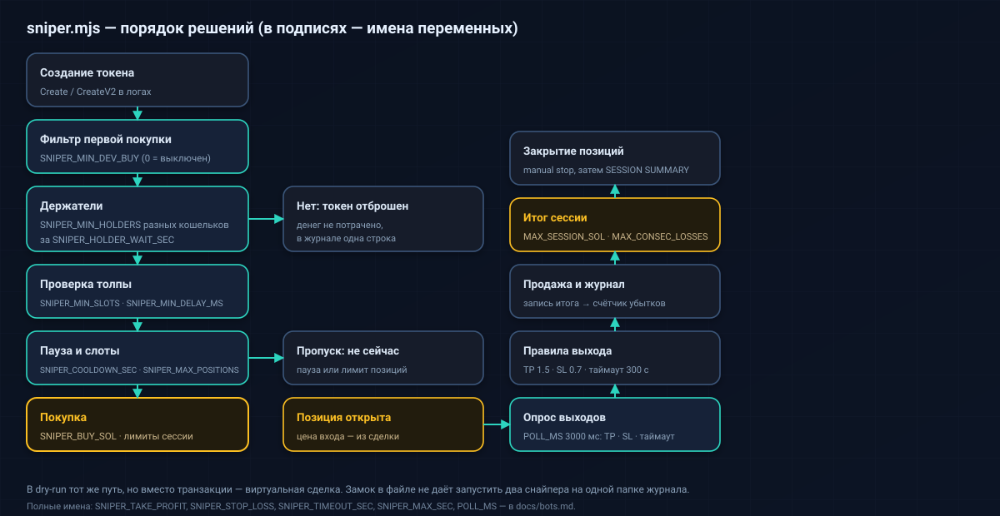
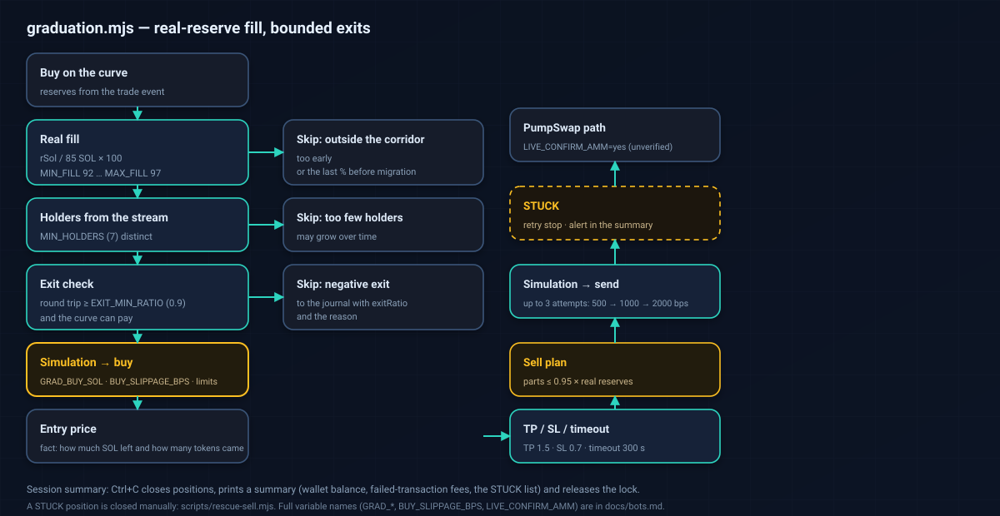

# Bots: who does what

The repo has several bots. Three of them **can trade** (and by default do
it virtually), the rest only read data.

Common rules for all:

- by default — **dry-run**: nothing is signed or sent;
- to enable real trading you need **two** switches: the `--live` flag and
  the `LIVE_CONFIRM=yes` variable in the same shell;
- all the values below come from `.env.example` (what you get after
  copying the template) or from the bot code when the template has no such variable.

## Quick table

| Bot | Command | What it does | Spends money? | Good for a beginner? |
|---|---|---|---|---|
| monitor | `npm run monitor` | shows new tokens and trades in real time | no, read-only | **yes**, start with it |
| sniper | `npm run sniper` | buys new tokens by filters | only with `--live` | yes, but run a long dry-run first |
| graduation | `npm run graduation` | enters before the curve migrates to PumpSwap | only with `--live` | no: subtle logic, the AMM sell is unverified |
| copy | `npm run copy` | repeats other wallets' trades | only with `--live` | no |
| trade | `npm run trade` | manual buy/sell with one command | only with `--live` | for one-off actions, not a strategy |
| analytics | `npm run analytics` | a local web dashboard | no | yes, but you need a browser and a free port |
| lab | `npm run lab` | paper trading with several rule sets | no (technically refused) | yes, if you want to collect statistics |
| replay | `npm run replay` | compares the lab results | no | no: you need accumulated data |

---

## monitor — a stream of new tokens (read-only)

**For whom:** everyone. This is the first run worth doing: it checks that
the RPC works and events arrive at all.

**What it does**

1. Connects to the WebSocket address (derived from `RPC_URL` by replacing `https` with `wss`).
2. Subscribes to the pump.fun program logs.
3. Prints every new token: its number, the token address (mint), the creator's address and the size
   of the author's first buy.

**Run**

```powershell
npm run monitor

# with a filter: show only tokens where the author bought at least 0.5 SOL
node bots/monitor/stream.mjs --filter-dev-buy 0.5
```

**Variables and flags**

| What | Default | Meaning |
|---|---|---|
| `RPC_URL` | required | without it the bot does not start |
| `--filter-dev-buy <SOL>` | off | hide small launches |
| `LOG_LEVEL` | `info` | `debug` gives more detail |

**Risk:** zero for money — the wallet is not used, no transaction is sent.

**Stop:** Ctrl+C; the bot prints how many token creations and trades it saw.

---

## sniper — buying new tokens

**What it does**

1. Catches a new token's creation.
2. Checks the size of the author's first buy (`SNIPER_MIN_DEV_BUY`).
3. Waits until several **distinct** wallets buy the token (`SNIPER_MIN_HOLDERS`), but not
   longer than `SNIPER_HOLDER_WAIT_SEC`; otherwise the token is dropped.
4. Checks the crowd's organic look: the number of distinct buy slots and the delay after creation.
5. Checks the pause between buys and the concurrent-position limit.
6. Passes the common limits (`MAX_TRADE_SOL`, `MAX_SESSION_SOL`) and buys.
7. Tracks the position and sells on take profit, stop loss or timeout.
8. After selling it watches the price for a while — to see whether it exited too early.

<p align="center"></p>

**Run**

```powershell
npm run sniper                        # dry-run
$env:LIVE_CONFIRM="yes"; npm run sniper -- --live    # real money
```

**Key variables (values from `.env.example`)**

| Variable | Value | Meaning |
|---|---|---|
| `SNIPER_BUY_SOL` | `0.02` | buy size in SOL (code default `0.1` if the variable is missing) |
| `SNIPER_TAKE_PROFIT` | `2.0` | sell when the price doubles |
| `SNIPER_STOP_LOSS` | `0.5` | sell when it falls to 0.5 of the entry price |
| `SNIPER_TIMEOUT_SEC` | `120` | max seconds in a position |
| `SNIPER_MAX_POSITIONS` | `3` | how many positions to hold at once |
| `SNIPER_MIN_DEV_BUY` | `0.5` | minimum author's first buy, SOL (`0` = don't check) |
| `SNIPER_COOLDOWN_SEC` | `10` | pause between buys |
| `SNIPER_MIN_HOLDERS` | `4` | how many distinct holders are needed before buying (`0` = buy immediately) |
| `SNIPER_HOLDER_WAIT_SEC` | `45` | how many seconds to wait for these holders |
| `SNIPER_MIN_SLOTS` | `1` | minimum distinct buy slots |
| `SNIPER_MIN_DELAY_MS` | `0` | delay after the token's creation, ms |
| `SNIPER_POST_EXIT_SEC` | `300` | how many seconds after the exit to watch the price (`0` = off) |
| `SNIPER_MAX_SEC` | unset | stop after N seconds (handy for short runs) |

**Where it writes:** `data/journal/…jsonl` — trades, skip reasons, session records;
separate files with price ticks and the holder-count growth.

**A failed sale:** up to `SELL_MAX_ATTEMPTS` attempts (default 3) with 2 s, 4 s, ... pauses; during the pause the position keeps being tracked (price and peak update). When the attempts run out — the position is marked STUCK: tokens stay in the wallet (`node scripts/rescue-sell.mjs`), the loss counts into `MAX_CONSEC_LOSSES` and the daily total.

**Risk:** medium for a beginner. The token may be a scam, a copy or a bundle
(one person buying from a dozen wallets). Filters reduce the risk but do not remove it.

**Stop:** Ctrl+C — the bot stops searching, closes positions (virtually in dry-run),
prints `SESSION SUMMARY`, then finishes the journal. A second Ctrl+C — exit immediately.

**Stall guard:** `STALL_GUARD_SEC` — the bot notices a console pause, resets the price cache and re-evaluates positions from the network; at a zero balance it looks for a landed sale (otherwise STUCK).

---

## graduation — entering before migration

**For whom:** those who already understand how the bonding curve works and read the code.

**What it does**

1. Computes the **real fill** of the curve: `realSolReserves / 85 SOL × 100`.
   The virtual reserves are ~30 SOL larger, so a virtual-based fill
   overstates the number by about a third.
2. Keeps the token only if the fill landed in the `GRAD_MIN_FILL_PCT` … corridor
   `GRAD_MAX_FILL_PCT` (default 92–97%) and at least
   `GRAD_MIN_HOLDERS` distinct buyers were seen in the stream.
3. Does a **pre-exit check**: computes buy-then-sell and
   refuses the entry if the round trip returns less than `EXIT_MIN_RATIO`
   (default 0.9) or the curve cannot pay.
4. Checks the common limits, simulates the buy and only then sends it.
5. Takes the entry price **from the actual transaction** (how much SOL left, how many tokens
   arrived), not from the calculation.
6. Exits when the sell price (minus the 1% fee) reaches
   `GRAD_TAKE_PROFIT`, falls to `GRAD_STOP_LOSS` or `GRAD_TIMEOUT_SEC` expires.
7. If the curve cannot pay the whole amount at once, the sale is split so
   each part fits within 0.95 of the real SOL reserves. After
   `SELL_MAX_ATTEMPTS` failures the position is marked **STUCK** and lands in the summary.

<p align="center"></p>

**Run**

```powershell
npm run graduation                                   # dry-run
$env:LIVE_CONFIRM="yes"; npm run graduation -- --live # real money
```

**Key variables (values from `.env.example`)**

| Variable | Value | Meaning |
|---|---|---|
| `GRAD_BUY_SOL` | `0.02` | buy size in SOL (code default `0.1`) |
| `GRAD_MIN_FILL_PCT` | `92` | minimum real fill, % (alias `MIN_FILL`) |
| `GRAD_MAX_FILL_PCT` | `97` | maximum fill; we do not touch the last 3% before migration (alias `MAX_FILL`) |
| `GRAD_MIN_HOLDERS` | `7` | minimum distinct buyers in the stream (alias `MIN_HOLDERS`) |
| `GRAD_TAKE_PROFIT` | `1.5` | take profit from the actual entry price |
| `GRAD_STOP_LOSS` | `0.7` | stop loss |
| `GRAD_TIMEOUT_SEC` | `300` | max seconds in a position |
| `GRAD_MAX_POSITIONS` | `3` | concurrent positions |
| `GRAD_COOLDOWN_SEC` | `30` | pause between buys |
| `EXIT_MIN_RATIO` | `0.9` (commented out) | the round-trip entry threshold |
| `SELL_MAX_ATTEMPTS` | `3` (commented out) | how many sell attempts before the STUCK status |
| `SELL_MAX_SLIPPAGE` | `2000` (commented out) | the sell slippage cap, bps |
| `BUY_SLIPPAGE_BPS` | `500` (commented out) | headroom on the max buy price |
| `LIVE_CONFIRM_AMM` | unset | `yes` allows the PumpSwap sell (an **unverified** path) |
| `DRY_SELL` | unset | `yes` — build and simulate the PumpSwap sell, but not send (for checking) |

**Where it writes:** `data/journal/…jsonl` (candidates, buys, sells, skip reasons),
`data/journal/graduation-blacklist.json` (tokens whose curve is already complete).

**Risk:** high and the most subtle. After migration the token goes to the PumpSwap pool, and that
sell path is **not verified on a real transaction** — so it is gated by a separate
`LIVE_CONFIRM_AMM=yes` switch. For migrated tokens it is safer to sell
manually via a wallet or another service.

**Stop:** Ctrl+C — a short pause to finish writing (up to 8 seconds), a summary, removing the
lock. A second Ctrl+C — exit immediately.

**Stall guard:** `STALL_GUARD_SEC` — after a console pause the bot re-evaluates positions from the network; at a zero balance it looks for a landed sale (otherwise STUCK).

---

## copy — repeating others' trades

**What it does**

1. Subscribes to events for the `COPY_TARGETS` addresses.
2. When a chosen wallet buys — opens its own position of `COPY_BUY_SOL`.
3. When it sells — sells `COPY_SELL_PCT`% of its position.
4. Respects the position limit and the common session limits.

**Run**

```powershell
npm run copy
$env:LIVE_CONFIRM="yes"; npm run copy -- --live
```

**Variables**

| Variable | Value in `.env.example` | Meaning |
|---|---|---|
| `COPY_TARGETS` | `wallet1,wallet2` (placeholders) | comma-separated addresses |
| `COPY_BUY_SOL` | `0.05` | the copy-buy size |
| `COPY_SELL_PCT` | `100` | what percent to sell after the target |
| `COPY_MAX_POSITIONS` | `5` | max concurrent positions |
| `COPY_MAX_HOLD_SEC` | `1800` | safety timeout: if the target has not sold within N seconds of our buy — the bot sells the whole remainder itself (ignoring `COPY_SELL_PCT`); `0` = off |

**Important:** the template has the `wallet1,wallet2` placeholders. Until you enter real
addresses, the bot does nothing — and that is correct.

**Sell retry and safety net:** a failed sale is retried by a timer every 2 s on a backoff (2 s, 4 s, ...), without waiting for the target's next sale; after `SELL_MAX_ATTEMPTS` attempts (default 3) — STUCK. `COPY_MAX_HOLD_SEC` is a safety net against a stuck position: if the target has not sold for N seconds, the bot sells the whole remainder itself, ignoring `COPY_SELL_PCT`; `0` = off; the bot has no TP/SL. On stop — one final attempt without waiting for the pause.

**Risk:** high. Copying is fragile: the target may be faster, sell in the same
block or turn out to be a bundle of dozens of linked wallets. No one guarantees an equal entry price.


**Stall guard:** `STALL_GUARD_SEC` — after a console pause the bot immediately checks the exits; at a zero balance it looks for a landed sale (otherwise STUCK).

---

## trade — manual commands

**What it does:** one command — one action. It builds the transaction with the same code as
the bots, but with no strategy and no position tracking.

```powershell
node bots/basic-trader/trade.mjs buy     <MINT> <SOL>
node bots/basic-trader/trade.mjs sell    <MINT> <percent|all>
node bots/basic-trader/trade.mjs price   <MINT>
node bots/basic-trader/trade.mjs balance <MINT>
node bots/basic-trader/trade.mjs wallet            # address and SOL balance
```

The same via npm:

```powershell
npm run trade -- price <MINT>
npm run trade -- buy <MINT> 0.01
$env:LIVE_CONFIRM="yes"; npm run trade -- sell <MINT> all --live
```

**Variables:** `SLIPPAGE_BPS` (default `500`), `MAX_TRADE_SOL`.
The bot prints a warning itself:

```
[CLI] Limits: only MAX_TRADE_SOL (X SOL) applies here; MAX_SESSION_SOL and MAX_CONSEC_LOSSES do NOT apply to the CLI bot.
```

**Risk:** medium. There is no session limit and no losing-streak stop here — only
the per-trade limit. A typo in the amount is bounded only by `MAX_TRADE_SOL`.

**Files:** writes nothing, no journal. This is a one-off command.

---

## analytics — a local dashboard

**What it does:** starts a local web server, collects statistics over the event stream
and serves a dashboard page and JSON at `http://localhost:<port>/api/stats`.

```powershell
npm run analytics
```

**Variables**

| Variable | Default | Meaning |
|---|---|---|
| `ANALYTICS_PORT` | `3000` | the local server's port |

The server listens only on `127.0.0.1`, so it is unreachable from outside. If the port is busy —
change `ANALYTICS_PORT` in `.env`.

**Risk:** zero for money (read-only). No wallet needed.

---

## lab — paper trading with variants

**What it does:** subscribes once to the event stream and simultaneously (!) runs
several rule sets, each with its own virtual account. That way variants are compared
on the same data, not on different days.

```powershell
npm run lab
```

The `--live` flag is refused on purpose:

```
lab.mjs is dry-run only: it never sends transactions. Remove --live.
```

**Variables (values from `.env.example`)**

| Variable | Value | Meaning |
|---|---|---|
| `LAB_BUY_SOL` | `0.02` | the paper buy size |
| `LAB_MIN_HOLDERS` | `4` | how many holders to wait for |
| `LAB_MIN_SLOTS` | `2` | minimum distinct buy slots |
| `LAB_MIN_DELAY_MS` | `2500` | delay after the token's creation |
| `LAB_WAIT_SEC` | `45` | the holder-wait window |
| `LAB_SAMPLES` | `30,60,120,300` | after how many seconds to record the price |
| `LAB_LATENCY_MS` | `600` | execution delay: we buy at the price no earlier than this moment |
| `LAB_TARGET_TRADES` | `1000` | the target for the time estimate in the status line |

**Where it writes:** `data/research/variants/<variant>.jsonl`.

**Risk:** no money. But the result here is only paper: without a long run and
a comparison on held-out data the numbers mean nothing.

---

## replay — comparing the lab variants

**What it does:** takes the files the lab collected, splits them into training and
test, and compares the variants with a bootstrap so a variant does not
win by chance.

```powershell
npm run replay
```

**Variables:** `REPLAY_MIN_TRADES` (`300`), `REPLAY_TEST_FRACTION` (`0.7`),
`REPLAY_RESAMPLES` (`2000`).

If there are fewer than `REPLAY_MIN_TRADES` trades, the script honestly refuses to conclude,
instead of inventing a result.

**Risk:** no money. You need accumulated data: without it, running is pointless.

---

## Extra tools (not among the eight above)

| Tool | Command | What it does |
|---|---|---|
| A graduation shadow run | `node bots/graduation-sniper/shadow.mjs` | paper trading of graduation strategy variants; writes `gshadow_*` to the journal |
| A rescue sell | `npm run rescue` | shows what can be sold from the leftovers, and (with `--live --mint`) sells; plan only by default |
| A bulk sell | `node scripts/sell-all.mjs` | lists all tokens in the wallet and (with `--live`) sells them one by one |
| Wallet/token analysis | `npm run analyze -- wallet <address>` | reconstructs the trade history from chain data |

About selling everything there is a separate warning — in the README, the Sell everything section.
