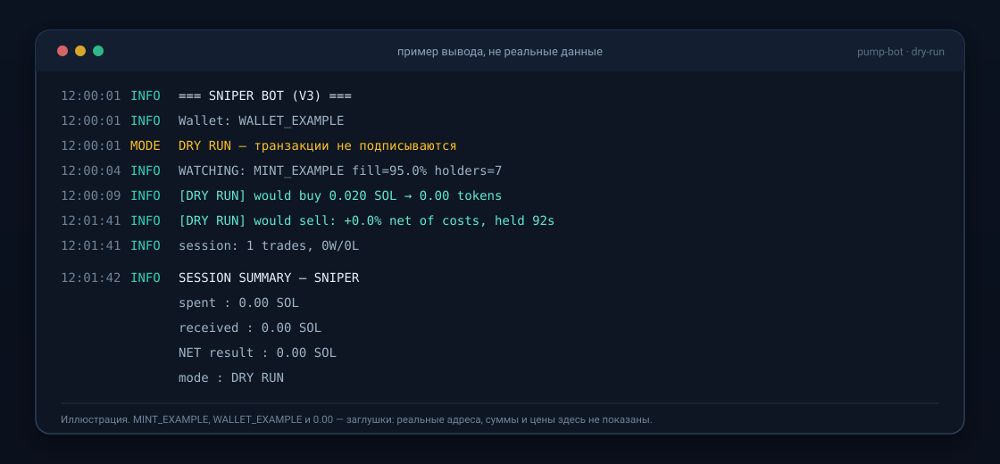
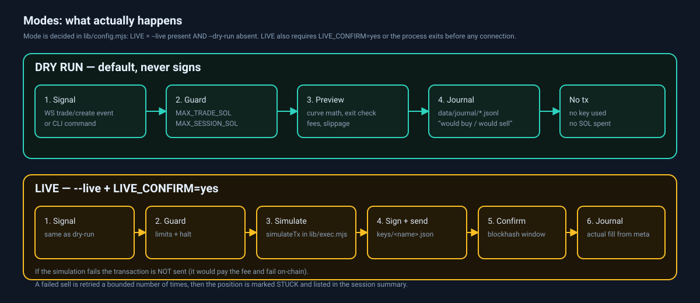

# С чего начать

Это пошаговое руководство для человека, который **раньше не запускал ботов**.
Мы пройдём путь от пустого компьютера до запущенного «виртуального» бота (dry-run),
который ничего не покупает и не тратит.

> Всё ниже сверено с кодом этого репозитория. Блоки вывода — **примеры** с
> плейсхолдерами (`MINT_EXAMPLE`, `0.00`), а не запись реальной сессии.

---

## 0. Что это за бот и чего он НЕ делает

**Что делает**

- следит за блокчейном Solana и замечает новые токены на pump.fun в момент появления;
- по заданным правилам решает «покупать или пропустить» (размер первой покупки автора
  токена, число разных держателей, лимиты на сумму);
- выходит по одному из трёх правил: take profit, stop loss или timeout;
- записывает каждое решение в журнал — файл `data/journal/ГГГГ-ММ-ДД.jsonl`;
- по умолчанию работает в режиме **dry-run**: считает и записывает, но не подписывает
  и не отправляет транзакции.

**Чего он НЕ делает**

- **не является финансовым советником**: он не знает, что будет с ценой дальше;
- **не гарантирует прибыль** и не обещает доходность — ни в документации, ни в логах;
- не «зарабатывает сам»: без ваших команд он ничего не делает;
- не выводит деньги на карту, не платит налоги и не отвечает за законность ваших действий;
- не умеет отменять уже отправленную транзакцию: блокчейн необратим.

Мемкоины — очень рискованный рынок: цена может упасть на 99% за минуту, а некоторые
токены **невозможно продать вообще**. Считайте, что деньги, которые вы вносите, можно
потерять полностью.

---

## 1. Что установить

### 1.1 Node.js 22 или новее

Бот написан на Node.js (это среда выполнения JavaScript). В `package.json` указано
требование `>=22`.

1. Откройте <https://nodejs.org> и скачайте **LTS-версию** (ветка 22 или новее).
2. Установите со стандартными настройками (кнопка «Next» до конца).
3. Откройте терминал (см. 1.3) и проверьте:

```powershell
node -v
npm -v
```

Ожидаемый результат — что-то вроде:

```
v22.11.0
10.9.0
```

Если вместо версии вы видите «команда не найдена» (`not recognized`,
`command not found`) — Node.js не установился или терминал был открыт до установки.
Закройте терминал, откройте заново и повторите.

### 1.2 Редактор кода

Подойдёт любой текстовый редактор, но удобнее всего **VS Code** (бесплатный):
<https://code.visualstudio.com>. Он нужен, чтобы открыть и отредактировать файл
`.env` (настройки); обычный «Блокнот» тоже справится.

### 1.3 Терминал

- **Windows:** «PowerShell» (найдите в меню «Пуск»). Все команды ниже даны для
  PowerShell. Не используйте «Командную строку» (`cmd`) — команды там другие.
- **macOS:** приложение «Терминал» (`Terminal`) или iTerm.
- **Linux:** любой терминал, оболочка `bash`.

Проверка, что вы в нужной папке: `pwd` (macOS/Linux) или `Get-Location` (Windows)
печатает текущий путь. Все команды из этого документа выполняются **из папки
проекта** — той, где лежит файл `package.json`.

### 1.4 Git (по желанию)

Git нужен, чтобы скачать код командой `git clone`. Если Git нет, скачайте архив ZIP
со страницы репозитория и распакуйте — результат тот же.

```powershell
git --version
```

---

## 2. Установка

### 2.1 Windows (PowerShell)

```powershell
# 1. Скачать код. Замените <URL-репозитория> на адрес, по которому вы получили проект
#    (например, https://github.com/ваш-логин/pump-bot.git).
git clone <URL-репозитория> pump-bot

# 2. Перейти в папку проекта
cd pump-bot

# 3. Поставить библиотеки ровно тех версий, что записаны в package-lock.json
npm ci --ignore-scripts

# 4. Создать свой файл настроек из шаблона
Copy-Item .env.example .env
```

### 2.2 macOS / Linux (bash)

```bash
# 1. Скачать код
git clone <URL-репозитория> pump-bot

# 2. Перейти в папку проекта
cd pump-bot

# 3. Поставить библиотеки
npm ci --ignore-scripts

# 4. Создать свой файл настроек из шаблона
cp .env.example .env
```

### 2.3 Что означают эти команды

| Команда | Что делает |
|---|---|
| `git clone <URL>` | копирует проект к вам на компьютер |
| `cd pump-bot` | переходит в папку проекта |
| `npm ci --ignore-scripts` | ставит 4 библиотеки из `package-lock.json` и **не** запускает служебные скрипты зависимостей. Ставьте именно `npm ci`, а не `npm install`: так версии совпадут с проверенными |
| `Copy-Item .env.example .env` | создаёт ваш личный файл настроек `.env` (в git он не попадает) |

> **Важно:** `.env` — личный файл. В нём будет адрес RPC с вашим ключом.
> Не отправляйте его в чат, не вставляйте в скриншоты и не коммитьте в git.

---

## 3. RPC_URL: что это и где взять

### 3.1 Объяснение простыми словами

**RPC** (Remote Procedure Call) — это «окно в блокчейн». Бот не хранит копию всей
Solana у вас на диске: он спрашивает данные у сервера RPC («сколько SOL на кошельке?»,
«какие события в новых блоках?»).

**RPC_URL** — адрес такого сервера, который вы вписываете в `.env`.

### 3.2 Почему нельзя взять «публичный бесплатный» адрес

Публичные адреса (`https://api.mainnet-beta.solana.com`) годятся, чтобы один раз
посмотреть баланс, но не для бота:

- у них жёсткие лимиты запросов — бот будет получать `429 Too Many Requests`;
- подписка на события (`logsSubscribe`, то есть «присылай мне все новые токены»)
  на публичных адресах обычно тормозится или не работает вовсе;
- в итоге бот выглядит «мёртвым»: процесс жив, а в консоли тишина.

Именно поэтому `lib/config.mjs` **требует** явно указать `RPC_URL` и не подставляет
публичный адрес по умолчанию.

### 3.3 Как получить собственный адрес

1. Выберите провайдера RPC: например, Helius (<https://helius.dev>), QuickNode,
   Triton или любого другого — принцип одинаковый.
2. Зарегистрируйтесь и создайте проект/приложение в панели провайдера.
3. Скопируйте выданный **HTTPS-адрес**. Обычно он выглядит так:

   ```
   https://mainnet.helius-rpc.com/?api-key=YOUR_KEY
   ```

   У некоторых провайдеров ключ передаётся отдельным заголовком — тогда возьмите
   «полный URL» из панели, если он там есть.

4. У Helius есть бесплатный тариф, но лимиты и условия меняются — **проверьте
   актуальные условия у провайдера**, прежде чем рассчитывать на бесплатный план.

> Ключ в адресе — это ваш платный (или ограниченный по квоте) доступ. Он не даёт
> доступа к деньгам, но позволяет тратить вашу квоту. Не публикуйте его.

### 3.4 Куда вставить

Откройте `.env` в редакторе (Windows: `notepad .env`) и замените строку

```dotenv
RPC_URL=https://mainnet.helius-rpc.com/?api-key=YOUR_HELIUS_API_KEY
```

на свою:

```dotenv
RPC_URL=https://ваш-адрес-от-провайдера/?api-key=ВАШ_КЛЮЧ
```

Правила, которые проверяет код:

- адрес обязан начинаться с `http://` или `https://`, иначе бот не запустится и
  напечатает `[config] ERROR: RPC_URL is required (must start with http:// or https://)...`;
- **WS_URL задавать не нужно**: адрес WebSocket (постоянного соединения для событий)
  бот получает сам, заменяя `https://` на `wss://`;
- `HELIUS_API_KEY` в шаблоне — отдельная необязательная переменная; для запуска
  достаточно `RPC_URL`.

### 3.5 Как проверить, что адрес рабочий

Самый быстрый способ — монитор (он только читает, ничего не покупает):

```powershell
npm run monitor
```

Если в течение минуты появляются строки `NEW TOKEN #1 ...`, всё работает.
Если тишина — смотрите раздел «Бот молчит» в
[errors-and-troubleshooting.md](errors-and-troubleshooting.md).

Остановить монитор: **Ctrl+C**.

---

## 4. Кошелёк

### 4.1 Что такое приватный ключ и публичный адрес

- **Публичный адрес** (public key) — как номер банковского счёта. Его можно
  показывать всем: по нему видно баланс и историю, но потратить деньги нельзя.
  В примерах ниже он обозначен как `WALLET_EXAMPLE`.
- **Приватный ключ** (secret key) — как подпись, которая разрешает тратить. Кто
  получил ключ, тот распоряжается всеми деньгами на адресе. Показывать его нельзя
  никому и никогда.

В этом проекте приватный ключ лежит **файлом на диске**. Ни пароля, ни шифрования,
ни аппаратного кошелька нет: файл прочитали — ключ получили.

### 4.2 Создание кошелька

Сначала должен существовать `.env` (шаги 2.1/2.2): `lib/wallet.mjs` читает настройки
из того же места и без `RPC_URL` не запустится.

```powershell
node lib/wallet.mjs generate      # создать кошелёк с именем по умолчанию
node lib/wallet.mjs show          # показать публичный адрес (без интернета)
```

Вывод будет примерно таким:

```
Generated keys/default.json
Public address: WALLET_EXAMPLE
```

Полезные детали (проверены в коде):

- имя кошелька — это имя файла: разрешены только латиница, цифры, `_` и `-`;
- повторный `generate` **не перезапишет** существующий файл, пока вы не добавите
  `--force`. Это защита от случайной потери уже пополненного кошелька;
- на macOS/Linux файл получает права `600` (читает только ваш пользователь).
  **В Windows это ограничение почти не действует** — защищайте свою учётную запись
  и не синхронизируйте папку `keys/` в общие облака.

### 4.3 Где именно лежит ключ

```
keys/default.json
```

Это **не seed-фраза** (не 12 слов). Внутри — массив из 64 чисел:

```json
[12, 34, 56, "… ещё 61 число …"]
```

Такой массив и есть приватный ключ в формате, который понимает Solana.

- папка `keys/` перечислена в `.gitignore` — git её не видит;
- проверить: команда `git ls-files keys` должна **ничего** не печатать;
- **потеря этого файла = потеря кошелька.** Восстановить нельзя: нет ни поддержки,
  ни «сброса пароля». Деньги останутся на адресе, но пользоваться ими вы не сможете.

### 4.4 Если нужно показать генерацию в обучающем видео или статье

Не создавайте `keys/` внутри репозитория. Укажите временную папку через переменную
окружения `KEYS_DIR` — код это поддерживает:

```bash
# macOS / Linux
KEYS_DIR=/tmp/demo-keys node lib/wallet.mjs generate demo
```

```powershell
# Windows PowerShell
$env:KEYS_DIR="C:\Temp\demo-keys"; node lib/wallet.mjs generate demo
```

Временную папку потом просто удалите: в репозитории не останется ни ключей, ни мусора.

### 4.5 Правила обращения с ключом

1. **Никому не отправляйте** `keys/` — ни в чат, ни в личку, ни «в поддержку».
2. **Никогда** не вставляйте содержимое файла в веб-сайты, формы, нейросети.
3. **Никогда** не делайте скриншот с открытым файлом ключа или с `.env`.
4. Сделайте **резервную копию** файла на офлайн-носитель (зашифрованная флешка,
   менеджер паролей). Не в облако и не в почту.
5. Если ключ всё же утёк — считайте кошелёк потерянным: создайте новый и переведите
   остаток туда. Отозвать приватный ключ нельзя.
6. Публичный адрес показывать можно — это безопасно.
7. **Не используйте свой основной кошелёк.** Только отдельный, «одноразовый», на
   сумму, которую не страшно потерять целиком.

---

## 5. Виртуальный запуск (dry-run): без денег

### 5.1 Что такое dry-run и почему он безопасен

**Dry-run** («сухой прогон», виртуальный запуск) — режим, в котором бот делает всё,
кроме последнего шага: он читает блокчейн, считает цену, принимает решения, пишет
журнал — но **не подписывает и не отправляет транзакции**.

Как это устроено в коде (`lib/config.mjs`):

```js
export const LIVE = argv.includes("--live") && !argv.includes("--dry-run");
export const DRY_RUN = !LIVE;
```

То есть: пока вы не добавили флаг `--live`, бот работает в dry-run. Это **режим по
умолчанию**, и он не требует ни денег на кошельке, ни ключа с балансом.

### 5.2 Запуск 1: монитор (только чтение)

```powershell
npm run monitor
```

Пример вывода (плейсхолдеры вместо реальных значений):

```
[INFO] Monitoring pump.fun V3 for new tokens...
[INFO]   Press Ctrl+C to stop
[INFO] NEW TOKEN #1 MINT_EXAMPLE creator=WALLET_EXAMPLE dev buy 0.42 SOL
```

Что это значит: бот увидел новый токен и показывает, кто его создал и сколько SOL
автор купил первым. Ничего не покупается.

### 5.3 Запуск 2: снайпер в dry-run

```powershell
npm run sniper
```

Что происходит:

1. бот подписывается на события pump.fun и ловит создание новых токенов;
2. проверяет фильтры (`SNIPER_MIN_DEV_BUY`, `SNIPER_MIN_HOLDERS` и другие);
3. если токен прошёл — «покупает» виртуально и ведёт позицию;
4. выходит по take profit, stop loss или timeout — тоже виртуально.

Ключевые строки в выводе:

| Строка | Что означает |
|---|---|
| `skip: <причина>` | токен или сделка отброшены; причина напечатана рядом. Денег это не стоит |
| `buying 0.02 SOL -> ~123456 tokens` | бот собирается «купить»; число токенов посчитано по кривой |
| `[DRY RUN] would buy — position tracked` | **виртуальная** покупка: позиция записана, транзакция не отправлена |
| `[DRY RUN] would sell: +12.3% net of costs (...)` | **виртуальная** продажа с результатом за вычетом комиссий |
| `session: 3 trades, 2W/1L` | счётчик сделок этой сессии |

> «would buy» — это «**купил бы**». Бот не покупал. Если вы видите эту строку,
> значит режим dry-run действительно работает.



*Это иллюстрация, а не реальный лог: `MINT_EXAMPLE`, `WALLET_EXAMPLE` и `0.00` стоят вместо
настоящих значений. Ваш вывод будет другим, но строки узнаваемые.*

### 5.4 Как остановить и что такое SESSION SUMMARY

Нажмите **Ctrl+C** один раз. Бот:

1. перестаёт принимать новые сигналы;
2. закрывает открытые позиции (в dry-run — виртуально, записывая причину `manual stop`);
3. печатает сводку `SESSION SUMMARY` и завершается.

Пример сводки (значения — плейсхолдеры):

```
[INFO] SESSION SUMMARY — SNIPER
[INFO] ================================================================
[INFO]   mode            : DRY RUN
[INFO]   stopped         : manual stop (Ctrl+C)
[INFO]   duration        : 12m 3s
[INFO]   buys / sells    : 1 / 1
[INFO]   spent           : 0.020000 SOL
[INFO]   received        : 0.021000 SOL
[INFO]   NET result      : 0.001000 SOL
[INFO]   costs           : 0.000900 SOL  (pump 1%+1%, slippage, priority fee)
[INFO]   NET after costs : 0.000100 SOL
[INFO]   closed trades   : 1W / 0L
[INFO]   open at stop    : 0 position(s)
[INFO]   note            : spent/received are gross — network + priority fees not deducted
```

Как читать:

- **spent / received** — «сколько отдал» / «сколько вернулось» (без вычета сетевых
  комиссий);
- **NET result** — received минус spent;
- **costs** — оценка комиссий: 1% на входе, 1% на выходе, проскальзывание,
  приоритетная комиссия. Это и есть главная причина, почему «плюс на бумаге» может
  оказаться минусом на практике;
- **NET after costs** — честный итог с учётом этих комиссий;
- в режиме live дополнительно печатается реальная разница баланса кошелька и список
  позиций **STUCK** (тех, что не удалось продать).

Второй Ctrl+C во время остановки завершает процесс сразу — это на случай, если
что-то зависло.

### 5.5 Запуск 3: лаборатория (бумажная торговля вариантов)

```powershell
npm run lab
```

Лаборатория подписывается на тот же поток событий и прогоняет **несколько наборов
правил одновременно**, каждому — свой виртуальный кошелёк. Деньги не тратятся,
кошелёк не нужен: она вообще не загружает ключ.

- флаг `--live` она **отклоняет** намеренно, сообщением
  `lab.mjs is dry-run only: it never sends transactions. Remove --live.`;
- результаты пишутся в `data/research/variants/*.jsonl`, по одному файлу на вариант;
- сравнивать варианты между собой умеет `npm run replay`.

Важно: одна сессия лаборатории ничего не доказывает. Это сбор данных, а не
доказательство, что какая-то настройка выгодна.

### 5.6 Куда бот пишет файлы

| Путь | Кто пишет | Что внутри |
|---|---|---|
| `data/journal/ГГГГ-ММ-ДД.jsonl` | снайпер, graduation-снайпер, копи-трейдер | по одной строке JSON на каждое решение и сделку |
| `data/journal/ticks-*.jsonl` | снайпер | цены позиции раз в секунду (файлы сменяются по размеру) |
| `data/journal/holders-*.jsonl` | снайпер | как росло число держателей |
| `data/journal/.sniper.lock`, `.graduation.lock` | боты | «замок» из PID: не даёт запустить два одинаковых бота на одной папке |
| `data/journal/graduation-blacklist.json` | graduation-снайпер | токены, у которых кривая уже завершена: их больше не покупаем |
| `data/research/variants/*.jsonl` | лаборатория | по одному файлу на вариант правил |
| `data/raw/*.jsonl.gz` | `npm run capture-raw` | сырые события, сжатые по часам |

Папка `data/` в git не попадает (она в `.gitignore`). Не выкладывайте её в публичный
репозиторий: там ваши адреса, суммы и результаты.

Прочитать журнал можно командой:

```powershell
npm run journal
```

---

## 6. Деньги и режим live: почему не спешить

<p align="center"></p>


### 6.1 На этапе dry-run деньги не нужны вообще

- кошелёк не обязан иметь баланс;
- транзакции не подписываются, значит комиссии не списываются;
- всё, что «тратится», — это время и трафик RPC.

Единственное, что нужно, — рабочий `RPC_URL`.

### 6.2 Почему live не для новичков

**Live** — режим, в котором бот подписывает настоящие транзакции ключом из `keys/` и
отправляет их в сеть. Здесь появляются реальные риски:

- цена может уйти вниз между решением и отправкой — вы получите меньше токенов;
- продажа может не пройти: кривая может «не иметь» SOL, чтобы выкупить ваши токены;
- каждая неудачная, но попавшая в блок транзакция **всё равно** списывает комиссию;
- ключ лежит файлом на диске — утечка файла означает потерю всех средств.

Поэтому порядок такой:

1. прочитать [security.md](security.md) — там описано, где лежит ключ, что делает
   код при подписи и что нельзя публиковать;
2. прогнать dry-run не один час и посмотреть журнал;
3. создать **отдельный** кошелёк и положить на него сумму, которую не страшно
   потерять целиком;
4. запускать live только с двумя переключателями (см. 6.3).

### 6.3 Два переключателя (защита, а не формальность)

Live включается **только** если одновременно выполнены два условия:

1. в командной строке есть флаг `--live`;
2. в этой же оболочке задана переменная `LIVE_CONFIRM=yes`.

Пример для PowerShell:

```powershell
$env:LIVE_CONFIRM="yes"; npm run sniper -- --live
```

Если забыть второй переключатель, бот остановится **до** подключения к сети:

```
[config] ERROR: --live requires LIVE_CONFIRM=yes. Set it for this run only, e.g. ...
```

Флаг `--dry-run` отменяет `--live`, даже если указаны оба.

Зачем так: скопированная из чата команда с `--live` не начнёт тратить деньги, пока
вы осознанно не зададите переменную в текущей сессии терминала.

Есть и дополнительный «третий ключ» для продажи на AMM (после миграции):
`LIVE_CONFIRM_AMM=yes`. Без него бот не отправляет продажу через PumpSwap — этот
путь в коде помечен как **непроверенный** на реальной транзакции.

---

## 7. Глоссарий

| Термин | Что это простыми словами |
|---|---|
| **SOL** | основная монета блокчейна Solana; в ней бот платит за покупки и комиссии |
| **lamport** | самая мелкая единица SOL: 1 SOL = 1 000 000 000 lamport. Внутри кода суммы считаются в lamport, чтобы не терять точность |
| **dry-run** | «сухой прогон»: бот всё считает и записывает, но не подписывает и не отправляет транзакции |
| **live** | «боевой» режим: транзакции подписываются реальным ключом и уходят в сеть |
| **bonding curve** | «кривая связи»: формула цены на pump.fun — чем больше токенов куплено, тем дороже следующий. Это не биржевой стакан |
| **graduation** (миграция) | момент, когда кривая заполнена и ликвидность переезжает в пул PumpSwap; после этого торговля идёт уже не по кривой |
| **slippage** (проскальзывание) | разница между ожидаемой и фактической ценой сделки; задаётся в «bps», где 500 bps = 5% |
| **take profit** (TP) | правило «продать, когда цена выросла до заданного множителя» (например, 2.0×) |
| **stop loss** (SL) | правило «продать, когда цена упала до заданного множителя» (например, 0.5×), чтобы ограничить убыток |
| **timeout** | правило «продать по времени»: если ничего не произошло за N секунд, позиция закрывается |
| **RPC** | сервер-посредник, через который бот читает блокчейн и отправляет транзакции (см. раздел 3) |
| **журнал** (journal) | файл `data/journal/*.jsonl`, куда бот пишет каждое своё решение; одна запись JSON на строку |

---

## 8. Частые ошибки

Полный список с объяснениями — в
[errors-and-troubleshooting.md](errors-and-troubleshooting.md). Самое частое:

| Симптом | Что делать |
|---|---|
| `[config] ERROR: RPC_URL is required` | нет файла `.env` или в нём пустой `RPC_URL`. Скопируйте `.env.example` в `.env` и впишите адрес |
| `--live requires LIVE_CONFIRM=yes` | задайте `$env:LIVE_CONFIRM="yes"` (PowerShell) в этой же сессии |
| `Keypair not found: ...\keys\default.json` | кошелёк не создан: `node lib/wallet.mjs generate` |
| `FATAL: another sniper instance is already running` | уже запущен второй снайпер. Закройте его через Ctrl+C: два бота на одной папке журнала испортят учёт |
| `bigint: Failed to load bindings, pure JS will be used` | **безопасное** предупреждение библиотеки, делать ничего не нужно |
| Бот запустился, но в консоли тишина | чаще всего упёрлись в лимит RPC (429) или публичный адрес не отдаёт события |
| `429 Too Many Requests` | исчерпана квота RPC: подождите, смените тариф или endpoint |

---

## 9. Что дальше

- все параметры и значения по умолчанию: [configuration.md](configuration.md);
- что делает каждый бот и какой у него риск: [bots.md](bots.md);
- все команды: [commands.md](commands.md);
- ключи и кошелёк подробнее: [wallet-and-keys.md](wallet-and-keys.md);
- безопасность: [security.md](security.md);
- что проверено, а что нет: [verification-status.md](verification-status.md).

Порядок, который избавит от большинства проблем: **монитор → снайпер в dry-run →
журнал → и только потом разговор про live**.
