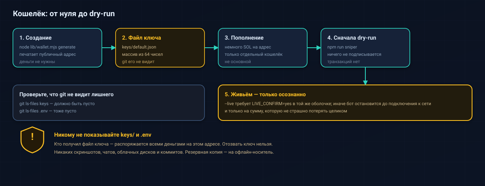

# Wallet and keys

<p align="center"></p>

Everything in this document happens **locally**. The bot never uploads your key, but the key file is
a plain secret on disk: treat it like cash.

> **Warning box — read this first**
>
> - Anyone who obtains `keys/<name>.json` (or the base58 string derived from it) **controls all funds**
>   in that wallet. There is no recovery, no support, no reversal.
> - **Never** paste the key into a website, a chat, an AI assistant, a screenshot, a ticket or a git
>   commit. Never share the `keys/` folder, `.env`, or a terminal window that shows them.
> - Use a **dedicated throwaway wallet** funded only with an amount you can afford to lose completely.
>   Do not reuse your main wallet and do not reuse a seed phrase you care about.
> - If you suspect a leak: generate a **new** wallet, move the remaining funds there, and stop using the
>   old one. A leaked key cannot be "revoked".

## 1. How the wallet is created

```bash
node lib/wallet.mjs generate          # name defaults to "default"
node lib/wallet.mjs generate main     # a second, separate wallet
```

What `lib/wallet.mjs` does (verified in the source):

1. Creates the `keys/` folder inside the repository root if it does not exist.
2. Generates a new Solana keypair.
3. Writes `keys/<name>.json` containing the **64-byte secret key as a JSON array of numbers**, e.g.
   `[12, 34, 56, ...]` (64 numbers — a placeholder, not a real key).
4. On POSIX it calls `fs.chmodSync(file, 0o600)` so only your user can read the file. **On Windows the
   mode is largely ignored**; the file inherits the folder's ACL, so protect your user account and do
   not sync that folder to a shared drive.
5. Prints the public address to the console.

`keys/` is listed in `.gitignore`. Verify that git really ignores it:

```bash
git ls-files | grep -E '^(keys/|\.env$)'   # must print nothing
```

## 2. Show the public address and the SOL balance

```bash
node lib/wallet.mjs show                # prints the public address (no network)
npm run trade -- wallet                 # prints the address and the SOL balance (needs RPC)
```

The public address is safe to share — it is the equivalent of an IBAN. The key file is not.

## 3. Where the private key is, and how to view it

`keys/<name>.json` **is** the private key: the 64-byte array is exactly what a wallet uses to sign.
There is no separate "export" command, by design.

Most wallet apps (Phantom, Solflare) expect the key as a **base58 string**, not a JSON array. Convert
it locally with the `bs58` dependency that is already installed:

```bash
node --input-type=module -e "import fs from 'node:fs'; import bs58 from 'bs58'; const k=JSON.parse(fs.readFileSync('keys/default.json','utf8')); process.stdout.write(bs58.encode(Uint8Array.from(k)));"
```

- The command prints the base58 string to **stdout**; it does not write any file and does not use the
  network. (`bs58` is `6.0.0` in `package.json`; the ESM default import was verified to work in this
  project. The command itself is **UNVERIFIED** end-to-end here because this repository's policy is
  not to touch a real `keys/` file.)
- Use it on your own machine, in a private terminal, with no screen sharing and no recording.
- Clear the clipboard and the terminal scrollback afterwards.

**Importing into a wallet app**

1. Open Phantom or Solflare → **Import / Add wallet** → **Import Private Key**.
2. Paste the base58 string from the command above.
3. Confirm that the imported address matches the one printed by `node lib/wallet.mjs show`.
4. Immediately clear the clipboard.

## 4. Backing up

- Copy `keys/<name>.json` to an **offline** medium (encrypted USB stick, or a password manager's
  secure note) — never to cloud sync, email drafts, or a repo.
- A backup of the JSON array and a backup of the base58 string are equivalent secrets.
- Keep at least two copies in different physical places if the amount matters to you.
- Do not store the backup next to `.env` or inside the project folder.

## 5. Funding the wallet

1. Send a **small** amount of SOL from an exchange or another wallet to the public address.
2. Keep a little extra for fees: every transaction pays a base fee plus a priority fee
   (`CU_PRICE × CU_LIMIT`, capped at 0.002 SOL per transaction by `lib/config.mjs`).
3. Prefer funding in steps: test with a tiny amount, run dry-run, then a single small live trade.

## 6. Withdrawing what is left

- **SOL:** send it from the wallet app (imported key) or from any wallet that holds the address — you
  do not need the bot for that.
- **Tokens:** `npm run trade -- sell <MINT> all` (add `--live` and `LIVE_CONFIRM=yes` to actually
  sell), or `npm run rescue` to inventory unsold tokens and see what a sale would return. A token whose
  curve cannot pay the sale is reported as STUCK; do not keep retrying it blindly.
- **Empty token accounts:** the bots create associated token accounts when needed; closing them
  manually is optional and only reclaims a small rent deposit.

## 7. Checking the wallet on a block explorer

Use the **public address only** (never the key):

```
https://solscan.io/account/<WALLET_ADDRESS>
```

You can verify balances, token holdings and transaction history there. Do not connect the wallet app
to random sites that ask for a signature "to verify" anything.

## 8. What the bot does with the key

- `lib/wallet.mjs` is the **only** module that reads `keys/<name>.json`
  (`fs.readFileSync` → `Keypair.fromSecretKey`).
- `lib/tx.mjs` signs the versioned transaction with that keypair; `lib/send.mjs` broadcasts the signed
  bytes.
- `lib/logger.mjs` masks secret-looking values in logs: byte arrays of 60+ integers,
  `secretKey=`/`privateKey=` blobs and base58 runs of 80–90 characters.
- The key is **never** sent over the network: only signatures leave your machine.
- No telemetry, no analytics endpoint, no third-party host is contacted with key material. The only
  outbound hosts are your `RPC_URL` and, optionally, the price sources in `lib/solprice.mjs`
  (disable them with `SOL_PRICE_SOURCE=off`).

## 9. If something goes wrong

| Situation | What to do |
|---|---|
| Key file accidentally committed | Treat it as leaked: generate a new wallet, move funds, remove the file from git **history** (a new commit is not enough), rotate the RPC key too |
| Key pasted into a site or chat | Move the funds immediately to a fresh wallet; assume the old one is compromised |
| `Keypair not found: …\keys\default.json` | You have not generated a wallet yet: `node lib/wallet.mjs generate` |
| Wallet has 0 SOL | Fund it, or stay in dry-run — dry-run never needs a funded wallet |
| Balance lower than expected after a session | Fees are real: base fee + priority fee per transaction, including failed ones that landed. The session summary prints the wallet delta and the estimated failed-transaction fees |

